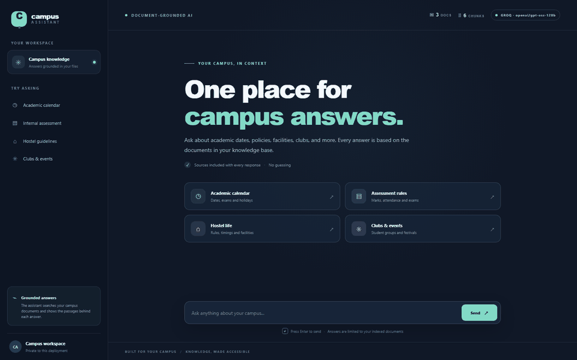

# RAG Campus Assistant

Ask questions about your college — syllabus, deadlines, hostel rules, club events — and
get answers **lifted from your own documents**, with a citation on every one. No
answers from the model's imagination, because the model is only ever shown the
passages that were retrieved for that question.

This is Flagship Project #1 on the portfolio roadmap (the "Currently Building" card).



**Stack:** FastAPI · ChromaDB · sentence-transformers · plain-JS SSE frontend.

**Read the case study:** [`docs/CASE_STUDY.md`](docs/CASE_STUDY.md) — architecture,
the retrieval bug the eval caught, and the honest limitations.

## Three things worth knowing up front

- **It works without an LLM key.** With no key it still embeds your question, searches
  the documents and returns the best passages with similarity scores.
- **The provider is auto-detected:** Groq → OpenAI → Ollama → retrieval-only. Add a key
  to `.env` and the same endpoint starts writing real answers. No code changes.
- **Answers stream.** Sources arrive first, then tokens, then a `done` event — all over
  one SSE response parsed with `fetch` and a 40-line reader.
- **Follow-ups keep context.** The UI sends the last few turns, short pronoun questions
  are expanded with the previous one before retrieval, and the model sees the exchange.
- **It says "I don't know".** Chunks below `MIN_SCORE` are dropped, so an off-topic
  question reaches the honest not-found reply instead of loosely related context.
- **Hybrid retrieval.** Cosine similarity is blended with a literal term-overlap bonus,
  so a short keyword question ("internal marks split") is not lost below the cutoff.
- **Measured, not guessed.** 10/10 source hits and 10/10 keyword recall on the golden
  set; the eval runs in CI on every push.

## Try asking

- "When is the mid-semester break?"
- "What are the CA marks split rules?"
- "Which club handles the tech fest?"
- "What does the attendance policy say?"

## How it works

```
data/docs/*.pdf|txt|md
        │  chunk (900 chars, 150 overlap) + embed
        ▼
    ChromaDB  ──persistent vector store──
        │  question → embed → top 12 by cosine
        │  hybrid score = cosine + 0.35 × lexical overlap
        │  MMR re-rank (λ=0.3) → top 4, de-duplicated
        ▼
   prompt: system rules + [1]..[4] excerpts + question
        ▼
  Groq │ OpenAI │ Ollama │ retrieval-only
        ▼
  SSE stream: sources → tokens → done
```

## Quickstart

```bash
# 1) create and activate a virtual environment
python -m venv .venv
.venv\Scripts\activate            # Windows
# source .venv/bin/activate       # macOS / Linux

# 2) install dependencies
pip install -r requirements.txt

# 3) optional — add an LLM key (skip this to run in retrieval-only mode)
copy .env.example .env            # Windows  (cp on macOS/Linux), then edit .env

# 4) ingest the documents (samples are included; drop your own PDFs in data/docs)
python -m app.ingest
# → Ingested 6 new chunks. Store total: 6 chunks across 3 documents.

# 5) run the server
uvicorn app.main:app --port 8123
```

Open **http://localhost:8123** — the chat UI is served at the root. Interactive API
docs live at **http://localhost:8123/docs**.

## With and without an API key

| | Without a key | With a key |
|---|---|---|
| Provider pill | red **RETRIEVAL-ONLY MODE** | `GROQ · openai/gpt-oss-120b` (or your model) |
| `/api/chat` returns | retrieved passages + scores, no generated text | streamed answer grounded in those passages |
| Setup | nothing | key in `.env` (free tier at console.groq.com) |

Nothing else changes between the two modes — same endpoint, same UI, same citations.

## API

| Endpoint | Method | Purpose |
|---|---|---|
| `/api/health` | GET | provider, model, chunk and document counts |
| `/api/chat` | POST | `{question, history?}` → SSE stream (sources → tokens → done) |
| `/api/ingest` | POST | wipe and re-ingest `data/docs` (needs `X-Admin-Token` when `ADMIN_TOKEN` is set) |
| `/docs` | GET | interactive OpenAPI docs |

## Project layout

```
app/
  main.py       FastAPI app: /api/health, /api/chat (SSE), /api/ingest, static mount
  config.py     env knobs + provider auto-detection
  llm.py        retrieval (MMR), prompt building, provider streamers
  ingest.py     document loading, chunking, embedding
  store.py      ChromaDB wrapper (metadata coercion, reset, counts)
  schemas.py    request/response models
static/         index.html, app.js (SSE reader), styles.css
tests/          test_api.py, test_chunking.py, test_retrieval.py
scripts/        eval_retrieval.py (hit-rate harness), deploy_hf_space.py, record_demo.py
data/docs/      source documents (txt/md/pdf) — samples included
data/eval/      golden.json — questions scored by the harness
docs/           case study, demo GIF and poster
deploy/         Hugging Face Space metadata (app_port: 7860)
Dockerfile      python:3.11-slim image, serves on $PORT (7860 by default)
.github/        tests.yml — pytest + retrieval eval on every push and PR to main
```

## Configuration

Everything in `.env` is optional; defaults shown.

| Variable | Default | What it does |
|---|---|---|
| `GROQ_API_KEY` / `OPENAI_API_KEY` | — | enables that provider (checked in that order) |
| `OLLAMA_URL` | `http://localhost:11434` | local Ollama endpoint |
| `OLLAMA_MODEL` | `llama3.1:8b` | local model to use |
| `GROQ_MODEL` | `openai/gpt-oss-120b` | Groq model override |
| `OPENAI_MODEL` | `gpt-4o-mini` | OpenAI model override |
| `CHUNK_SIZE` | `900` | characters per chunk |
| `CHUNK_OVERLAP` | `150` | characters shared by neighbouring chunks |
| `TOP_K` | `4` | passages sent to the model |
| `FETCH_K` | `12` | candidates fetched before MMR re-ranking |
| `MIN_SCORE` | `0.45` | drop chunks below this hybrid score; measured on the golden set |
| `LEXICAL_WEIGHT` | `0.35` | weight of literal term overlap in the hybrid score |
| `HISTORY_TURNS` | `6` | earlier messages kept as conversation context |
| `ADMIN_TOKEN` | *(empty)* | when set, `/api/ingest` requires an `X-Admin-Token` header |
| `RATE_LIMIT` | `20` | chat requests per IP per window (`0` disables) |
| `RATE_WINDOW` | `60` | rate-limit window in seconds |
| `LLM_TEMP` | `0.2` | sampling temperature |
| `LLM_MAX_TOKENS` | `700` | answer length cap |

## Testing

```bash
python -m pytest tests/ -v
```

45 tests (~1.5s) covering chunking edge cases, PDF fallback, metadata coercion,
retrieval fallback, the `MIN_SCORE` cutoff, follow-up query expansion, rate limiting,
the admin-token gate, and the full API surface via injected fakes.

## Docker and CI

```bash
docker build -t campus-assistant .
docker run --rm -p 8123:8123 -e PORT=8123 campus-assistant
```

The image serves on `$PORT` (7860 by default) so it can be deployed directly to
Hugging Face Spaces. `.dockerignore` keeps `.venv`, the vector store and logs out
of the build context. `.github/workflows/tests.yml` runs the test suite **and** the
retrieval eval on every push and pull request to `main`.

## Deploy a public demo

```bash
pip install huggingface_hub
huggingface-cli login
python scripts/deploy_hf_space.py --repo-id <user>/rag-campus-assistant --groq-key gsk_...
```

The script creates a Docker Space, uploads the app without local state or secrets,
and sets `GROQ_API_KEY` as a Space secret. Omit `--groq-key` to deploy in
retrieval-only mode.

## Retrieval evaluation

```bash
python scripts/eval_retrieval.py            # exits non-zero below 90%
python scripts/eval_retrieval.py --verbose  # show every retrieved chunk
```

Runs the real retrieval path over `data/eval/golden.json` and reports source hit-rate
and keyword recall. Current baseline on the sample corpus: **10/10 source hits and
10/10 keyword recall**, which is what the `MIN_SCORE=0.45` default is tuned against.
On-topic top hits score 0.45–0.95; off-topic ones stay near 0.20–0.35. Add your own
cases as the corpus grows.

## Why these design choices

Short answers for the "why did you build it that way" question in an interview.

- **Character-overlap chunking, not semantic splitting.** These documents concentrate
  each answer on a single page, so deterministic chunks with page metadata keep
  citations precise. Semantic splitting would add a dependency and cost without a
  measurable gain here.
- **MMR instead of plain top-k.** Cosine top-k happily returns four near-identical
  chunks when one rule appears on several pages. Greedy MMR with a λ=0.3 Jaccard
  redundancy penalty diversifies the context.
- **Hybrid scoring, because the eval caught a bug.** "What is the internal marks
  split?" scored 0.297 against the chunk headed `INTERNAL MARKS STRUCTURE` and was
  dropped by the cutoff. Lowering the threshold would have admitted off-topic noise,
  so the ranker now adds a 0.35 × literal-term-overlap bonus. Same chunk: 0.531.
  Raw cosine is still reported alongside the hybrid score.
- **Page numbers stored as strings.** ChromaDB only accepts scalar metadata, and a
  `None` page from a label-less PDF would crash ingestion. Values are coerced on write
  and restored to `int | None` on read.
- **SSE instead of WebSockets.** Token flow is one-way, so SSE needs no extra
  dependency, survives every proxy, and parses in a few dozen lines.

## Roadmap

- [x] Evaluation harness: golden Q/A set + retrieval hit-rate scoring
- [x] Conversational memory (follow-up questions)
- [x] Demo GIF for the portfolio card (`docs/demo.gif`)
- [x] Hybrid lexical scoring (10/10 on the golden set)
- [ ] Hosted public demo (`scripts/deploy_hf_space.py` is ready)
- [ ] Cross-encoder reranker, measured against the current baseline

## License

MIT — see [LICENSE](LICENSE).
